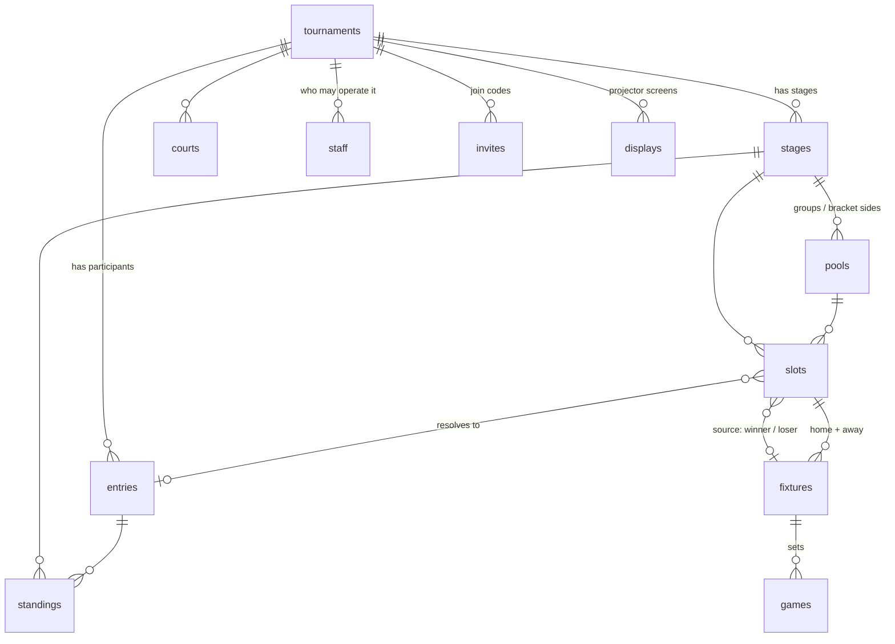

# Data model

## Two decisions everything else follows from

### 1. A tournament is an ordered list of stages, not a fixed shape

Each stage carries its own format. "Groups, then playoff" and "playoff, then
groups" are not two kinds of tournament — they are the same structure with a
different `stages.position`. Adding a consolation bracket or a Swiss round at
the front means inserting a row, not touching the schema.

### 2. A position exists before the participant who fills it

A **slot** is a place that gets filled later: "Winner of QF1", "1st of Pool A".
Until its source resolves, `slot.entry` is null and `slot.label` is displayed.

This is the entire reason the table exists. Without it you cannot draw a
bracket before you know the names — and that is exactly what the projector has
to show all morning, while the group stage is still deciding who is in it.



## Collections

| Collection | What it is |
|---|---|
| `tournaments` | The event. Owner, sport, scoring and tiebreak config. |
| `staff` | Who may operate it (`organizer` / `referee` / `scorer`), and the name they gave when they joined. |
| `invites` | A join code: one unguessable token per role, scanned off the organiser's phone. |
| `courts` | Playing areas. Used by the schedule and the projector. |
| `entries` | A participant — team or individual. `short_name` is what the projector draws. |
| `stages` | A phase. `position` + `format` + `config`. |
| `pools` | A self-contained sub-competition inside a stage: one round-robin group, or one side of a double-elimination bracket. |
| `slots` | A fillable position. The core of the model. |
| `fixtures` | A match. |
| `games` | Sets / legs / maps inside a fixture. |
| `standings` | A table. Materialised, not a SQL view. |
| `displays` | A projector screen. |
| `fixture_events` | Append-only: who changed a result, to what, and from what. |

## How a playoff hangs off a group stage

A playoff slot has no `entry`, but it does have a source:

```json
{
  "source_type": "pool_rank",
  "source_pool": "<id of pool A>",
  "source_position": 1,
  "label": "1. A",
  "entry": null
}
```

When pool A finishes, the server recomputes `standings`, finds every slot whose
`source_type` is `pool_rank` pointing at that pool, and fills in `entry`. The
same mechanism handles progression inside a bracket (`fixture_winner`,
`fixture_loser`).

One mechanism, every direction of progression. That is why playoff-first needs
no special case.

**Slots only resolve once the source pool is complete.** Every fixture in it
must be settled. A table is provisional until then, and promoting a
provisionally-first team into the playoff is the single worst bug this system
could have.

Generating such a bracket is one call:

```json
// stages.config on the playoff stage
{ "seedFrom": { "stage": "<groups stage id>", "advancePerPool": 2 } }
```

Qualifiers are ordered by rank first, then by pool — A1 B1 C1 D1 A2 B2 C2 D2 —
which, combined with standard bracket seeding, guarantees no two entries from
the same pool meet in round 1.

## How a second person gets in

`staff` gates every write below a tournament and there is no way to insert a
row into it directly — its create rule is owner-only, and the person joining is
by definition not the owner. `invites` is the way in.

An invite is a token, a role, and an `active` flag. It is modelled on
`displays` rather than on an email address: the referee is standing next to the
organiser, so the unguessable token on a QR code is both the invitation and the
authentication. There is one row per role, not per person — the organiser shows
the referee code to whoever turns up, all morning.

`POST /api/staff/join` is what turns one into a `staff` row. It takes a session
rather than a name, because the account already exists by the time it is
called: the join screen makes a device account the same way the wizard makes
the organiser's, and a referee who has claimed theirs simply arrives as the
account they already have. The route writes the staff row with `app.Save`,
which does not go through collection rules — the invite is the authority
instead, and only the owner could have minted it.

Two revocations, and they are not the same one:

| | |
|---|---|
| `invites.active = false` | Withdraws the *link*. A code that got out stops working; everyone who already used it stays. |
| Delete the `staff` row | Removes one *person*. The device in their pocket stops writing immediately. |

The name on the staff row is what that person typed when they scanned. It is
there rather than on the account because the users collection lets an account
view itself and nobody else — so without it, an owner could hold a complete
`fixture_events` log of who changed which result and be unable to render a
single one of those names.

## The table a pool cannot produce

One format does not fit the above: *the best four third-placed teams also go
through*. That is a comparison between teams who were never in the same pool
and never played each other, so there is no position in any pool table that
expresses it. It is what `stage_rank` slots and the stage-wide table exist for,
and `"bestOfNext": 4` alongside `advancePerPool` is how a stage asks for one.

A stage table is stored in `standings` like any other, with `pool` unset. Two
rules make it a fair ranking rather than a merged list.

**Group position comes first.** The table runs tier by tier: every pool's
winner, then every runner-up, then every third place. A runner-up never
outranks a winner however good its record. That is what the rulebooks say, and
it is what gives a position in the table a meaning worth pointing a slot at —
with four pools and two qualifying automatically, positions 9..12 *are* the
third-placed teams, in order, so the best two of them are 9 and 10.

**Records are compared over the same number of matches.** Snaked pools are not
always equal — ten teams in three pools is 4/3/3 — and a team out of the pool
of four has played a match the others have not. So the table keeps the top `m`
places of every pool, where `m` is the smallest pool, and disregards every
result against the teams below that. It is a re-tally rather than a re-sort:
you cannot subtract a match from a total after the fact and still get the
tiebreaks right.

The pool tables themselves are untouched by any of this. Truncation decides the
order *within* a tier; which tier a team is in comes from its own pool's real
table.

Like a pool table, a stage table is kept up to date from the first result and
is provisional until the last one — the third-place race is the thing everyone
in the hall is watching. And like `pool_rank`, nothing is *seeded* from it
until it is final. The difference is what "final" means: a `pool_rank` slot
fills as soon as its own pool is complete, while a `stage_rank` slot waits for
every pool in the stage, because the group still playing may yet produce a
better third place.

## The one format that cannot be written up front

A bracket and a round robin are generated once and played to the end. A Swiss
round is a function of the table, and the table is a function of the rounds
already played — so `PlanSwiss` writes one pool, one slot per entry and round
one, and stops. The rest is drawn by `PairNextRound` as the results come in,
off the back of the same hook that rebuilds the tables.

Three consequences, all in `backend/internal/tournament/swiss.go`:

- **A round is drawn from the rounds behind it, never from the one it is in.**
  The pairing reads the table as it stood at the end of the last complete
  round, which makes it a pure function of finished rounds — so drawing it
  twice produces the same round twice. That matters more than it sounds: an
  odd field means a bye, a bye settles itself the instant it is written, and
  that write re-enters the hook that draws rounds. Let the table include the
  round being drawn and the stage redraws itself for ever.
- **Avoiding a rematch is the hard constraint; the fold is the preference.**
  Each score group is split in half and the top half plays the bottom half,
  with an odd group floating its last team down. Where that repeats a meeting
  the pair is transposed, and where a whole group is stuck the search
  backtracks into the groups above it. A repeat is only allowed once no
  rematch-free round exists at all, and the pairing says so when it happens.
- **A Swiss bye is not a bracket bye.** They are the same record — settled,
  one side empty — and mean opposite things. In a bracket it is a free pass to
  the next round and counts for nothing, which is why the tables skip it. In a
  Swiss it *is* the round, and scoring it zero would drop whoever sat out to
  the bottom for having been the odd one out, so it takes the points for a
  win. `standings.go` tells them apart by the stage's format, and the bye goes
  to the lowest-ranked team that has not already had one.

The knock-on for slot resolution is that **a Swiss pool is not complete when
its fixtures are.** After round one every fixture in it is settled and the pool
still owes three rounds; `PoolComplete` therefore also asks whether the rounds
have all been drawn, or a playoff seeded from the table would take the top four
of a table two rounds short.

A round already on the wall is redrawn when a result behind it is corrected —
but only while neither it nor anything after it has been played. A corrected
score has to produce the table it would have produced at the time; matches
already played cannot be unplayed to match it.

## Deliberate impurities

**`fixtures.home_entry` / `away_entry` are denormalised from the slots.**
Without them the projector would have to read `fixtures` → `slots` → `entries`,
two levels of expand. With them it is one query. The cost is that the resolver
has to maintain both — which it does anyway, since it writes both in the same
transaction. The slot is authoritative; `fixtures.*_entry` is cache.

**`standings` is a table, not a view.** SQL can compute points and goal
difference, but not head-to-head — and head-to-head is the first tiebreak in
almost every sport's rules. The server recomputes after each settled fixture
and writes the result, including a `tiebreak` audit recording which criteria
were applied in which order. When somebody disputes a qualification after the
tournament, that field ends the argument. Write rules are nil: only hooks and
superusers touch it.

Three consequences of how ranking works, in `backend/internal/tournament/standings.go`:

- **Tables are rebuilt from scratch, never accumulated.** A score corrected two
  hours later has to yield the same table as if it had been right the first
  time, and incremental accumulation is precisely where that guarantee breaks.
- **A walkover is an outcome without a score.** The table counts `finished`
  and `walkover` and skips `bye` — a bye is settled, but nobody played it —
  except in a Swiss stage, where the bye *is* somebody's round and scores as a
  win. The organiser names the winner, who takes the points for a win and
  `scoring.walkoverScore` (0 by default) as a nominal score — head-to-head
  therefore reads `winner` rather than comparing scores, or a walkover would
  rank as a draw between the team that turned up and the team that did not.
- **Ranking is recursive, not a comparator chain.** Head-to-head is computed
  only among the entries that are actually tied, from the fixtures they played
  against each other. A global comparator cannot see that context, so the
  ranker sorts, groups the still-tied rows, and recurses with the next
  criterion. The default order is
  `points → head_to_head → score_diff → score_for → sub_diff → seed`,
  overridable per tournament via `tournaments.scoring.tiebreakers`.

**`games` is separate even though the scores would fit in a JSON column.** You
need to query "how many sets has team X won in total" for tiebreaks, and that
is not reasonable through JSON.

## Naming: SQL keywords

SQLite reserves `GROUP`, `ORDER`, `MATCH`, `INDEX`, `KEY`, `RANK` and `FILTER`.
All seven are natural words in this domain, so all seven are deliberately
renamed at the storage layer:

| Natural word | In the database | Where |
|---|---|---|
| group | `pool` / `pools` | a group, or a bracket side |
| order | `position` | everywhere |
| match | `fixture` / `fixtures` | a match |
| index | `number` | `games.number` = set number |
| key | `token` | `displays.token` |
| rank | `position` | `standings.position` |
| filter | `scope` | `displays.scope` |

Use "Group A" and "Match" freely in the UI — the renaming is a storage concern.

## Two storage constraints worth remembering

**Uniqueness has to include the pool.** `fixtures` and `slots` are keyed on
`(stage, COALESCE(pool, ''), round, position)`. Leaving the pool out looks
correct for a bracket and breaks the moment a stage has two groups, since pool
A and pool B both hold a fixture at round 0, position 0.

**A required number field rejects 0.** PocketBase validates `required` as "not
blank" and treats 0 as blank, so every zero-based ordering column here (stage
and pool `position`, slot and fixture `round`/`position`) has to be declared
optional. The unique indexes are what actually protect ordering. Fields that
are genuinely 1-based — `games.number`, `standings.position` — stay required.

## The projector

`displays.token` in the URL is the screen's only credential, so it can be
opened on a borrowed laptop without logging in. The read rule is:

```
active = true && token = @request.query.token || (<the tournament's staff>)
```

Anonymously, `listRule` therefore cannot be used to enumerate screens — without
the token it returns nothing. The staff branch was added later, and only
because it was missing: the owner could not ask which screens their own
tournament had, which nobody noticed while the only device that could organise
a tournament was the one that had generated the token in the first place.

Screens read `GET /api/display/{token}` rather than the collections directly:
one request returns stages, tables, fixtures, courts and theme already
assembled, instead of five subscriptions joined in the browser.

Three details that matter for a screen:

- **Entries are sent once** as a lookup map keyed by id and referenced from
  every fixture, so a team's name and logo are not repeated dozens of times.
- **Unresolved sides carry a label.** A fixture side with no entry yet sends
  `{ "entry": "", "label": "Winner SF1" }`, so the projector always has
  something to draw.
- **Reading is cheap.** The response is tagged; send it back in
  `If-None-Match` and an unchanged tournament answers 304. The tag excludes
  the generation timestamp, so it only changes when the tournament does.
- **A screen is configured, not coded.** `displays` carries `panels` (the
  rotation: which panels, in which order — empty means all of them in the
  running order, so a screen nobody has set up still picks up a panel added
  next month), `mode` (the older way to pin a screen to one panel; a rotation
  of one says the same thing, and the organiser UI writes `auto`),
  `rotate_seconds`, `scope` (one stage, group or court) and `theme`.
  The organiser writes them from the results screen and the wall follows on
  the next nudge, which is what makes the wall the preview.
- **A screen is told when to read.** Every write to anything a screen renders
  broadcasts a nudge on `tournament/{id}` over PocketBase's realtime stream —
  the fact of the change, never the change itself. Screens still hold a slow
  poll underneath: a socket that looks open and has stopped delivering is the
  failure worth designing for.

A draft tournament returns 404 rather than 403, so the endpoint cannot be used
to probe for unpublished events.

## The one thing on a screen somebody pays for

The rotation ends on a panel crediting Seedly, and that panel carries the
screen's sponsor slots — `displays.theme.sponsors`, a list of
`{ name, logo, tier }` — while the tournament's owner is subscribed.

**It is one date on the user.** `users.subscription_until`, and nothing beside
it. The subscription is on the user because that is what is bought — somebody
who runs four events a year does not buy it four times — and it is a date
because a date already answers both questions anyone asks of it: whether the
account is paying, and whether it used to. Empty never subscribed, a date in
the past has lapsed, and a subscription meant to last is written far ahead.
There is no value meaning "for ever", and no plan column: tiers, if there are
ever any, are a select added then and backfilled from this, which is cheaper
than two columns that can disagree about a distinction nothing yet makes.

**The filtering happens on the server.** `GET /api/display/{token}` is public
and needs no login, so an unsubscribed tournament sends `sponsors: []` rather
than sending them with a flag for the browser to respect. The owner is only
looked up when a theme actually has sponsors in it, so an ordinary screen
re-reading the payload does not touch the user table at all, and neither a
theme that will not parse nor an owner who cannot be loaded fails the payload —
that costs the sponsors, not the scoreboard.

**Nothing else guards the field.** It sits on a record its owner is allowed to
write, which is what lets an organiser put an email on a device account, and a
collection rule cannot say "every field except this one". So the exception is a
hook (`RegisterSubscriptionGuard`), bound to the *request* events only:
whatever grants a subscription server-side goes through `app.Save` and is
unaffected. The field is writable — just not by the account it is about.

## What the model does not solve yet

- **A best-of-next bracket can draw two pool-mates together in round 1.** The
  ordinary qualifiers are laid out so that cannot happen. Which pools the
  best-of-next teams came from is not known when the bracket is drawn, so they
  are appended as the lowest seeds and the guarantee does not extend to them.
  Competitions that care publish a lookup table of every possible combination.
- **The ladder generator.** `stages.format` accepts `ladder` and nothing
  builds one. Round robin, single and double elimination and Swiss all do.
- **Schedule conflicts are a warning, not a constraint.** The organiser screen
  says when a team is already down for another match within the hour and a
  half; the database will happily store it either way.
- ~~**Result history.**~~ Done: `fixture_events` is append-only and written
  only by the request hooks, so it records what a *person* did — the resolver
  rewrites fixtures constantly and none of that is somebody changing a result.
