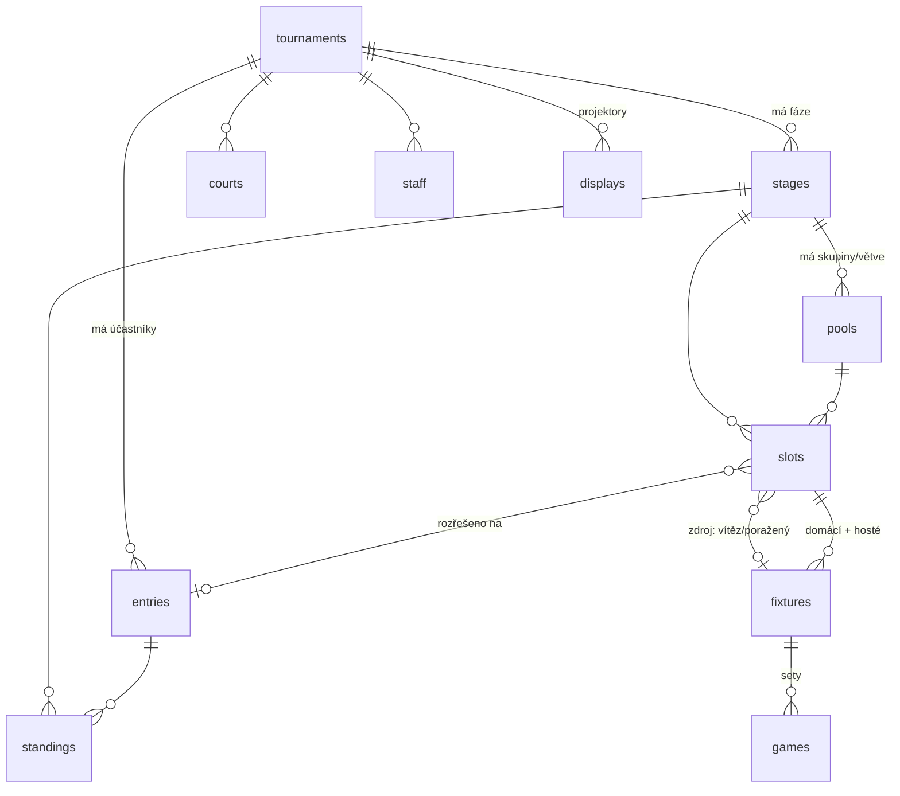

# Seedly — datový model

## Dvě rozhodnutí, ze kterých plyne všechno ostatní

**1. Turnaj je uspořádaný seznam fází (`stages`), ne pevná struktura.**

Každá fáze má vlastní formát. „Skupiny a pak playoff" a „playoff a pak skupiny"
nejsou dva různé typy turnaje — je to stejná struktura s jiným `stages.position`.
Přidat útěchovou větev nebo Swiss kolo na začátek znamená vložit další řádek,
ne sáhnout do schématu.

**2. Pozice v turnaji (`slots`) existuje dřív než účastník, který ji obsadí.**

Slot je místo, které se teprve naplní: „Vítěz QF1", „1. ze skupiny A". Dokud
zdroj nedoběhne, `slot.entry` je `null` a zobrazuje se `slot.label`.

Tohle je celý důvod, proč tabulka existuje. Bez ní nemůžeš vykreslit pavouka,
dokud neznáš jména — a přesně to potřebuješ na projektoru celé dopoledne, kdy
se hrají skupiny a diváci chtějí vidět, o co se hraje.



## Kolekce

| Kolekce | Co to je |
|---|---|
| `tournaments` | Akce. Vlastník, sport, konfigurace bodování a tiebreaků. |
| `staff` | Kdo smí turnaj obsluhovat (`organizer` / `referee` / `scorer`). |
| `courts` | Kurty/stoly. Používá rozpis a projektor („Kurt 3: další zápas"). |
| `entries` | Účastník — tým i jednotlivec. `short_name` je to, co kreslí projektor. |
| `stages` | Fáze. `position` + `format` + `config`. |
| `pools` | Samostatná podsoutěž uvnitř fáze: jedna skupina, nebo jedna větev dvojité vyřazovačky. |
| `slots` | Naplnitelná pozice. Jádro celého modelu. |
| `fixtures` | Zápas. |
| `games` | Sety/legy uvnitř zápasu. |
| `standings` | Tabulka. Materializovaná, ne SQL view. |
| `displays` | Projekční obrazovka. |

## Jak vzniká „playoff navázané na skupiny"

Slot v playoff nemá `entry`, ale má zdroj:

```js
{ source_type: "pool_rank", source_pool: <id skupiny A>, source_position: 1,
  label: "1. A", entry: null }
```

Když skupina A doběhne, engine přepočítá `standings`, najde všechny sloty se
`source_type: "pool_rank"` mířící na tuhle skupinu a doplní jim `entry`.
Stejný mechanismus řeší postup uvnitř pavouka (`fixture_winner` /
`fixture_loser`) i navázání skupiny na předchozí playoff (`stage_rank`).

Jeden mechanismus, všechny směry postupu. Proto model zvládne i „playoff na
začátku" bez zvláštního případu.

## Záměrné odchylky od čistoty

**`fixtures.home_entry` / `away_entry` jsou denormalizované ze slotů.**
Bez toho by projektor musel číst `fixtures` → `slots` → `entries`, tedy dvě
úrovně expandu. S tím je to jeden dotaz. Cenou je, že engine musí obě pole
udržovat — což stejně dělá, protože zapisuje obojí ve stejné transakci.
Autorita je `slot`; `fixtures.*_entry` je cache.

**`standings` je tabulka, ne view.** V SQL se dá spočítat body i skóre, ale
ne vzájemný zápas — a ten je v pravidlech skoro každého sportu první tiebreak.
Engine tabulku přepočítá po každém uzavřeném zápase a zapíše včetně `tiebreak`
auditu (která kritéria se v jakém pořadí použila). Až se někdo bude po turnaji
hádat o postup, tohle pole spor ukončí. Zápisová pravidla jsou `null` — mění
to jen hook, ne klient.

**`games` je zvlášť, i když by se skóre vešlo do JSONu.** Chceš dotazovat
„kolik setů vyhrál tým X celkem" kvůli tiebreakům; přes JSON to nejde rozumně.

## Názvosloví: pozor na SQL klíčová slova

SQLite si rezervuje `GROUP`, `ORDER`, `MATCH`, `INDEX`, `KEY`, `RANK`, `FILTER`.
Všechna jsou v téhle doméně přirozená, a všechna jsou proto na úrovni úložiště
záměrně přejmenovaná:

| Přirozeně | V DB | Kde |
|---|---|---|
| group | `pool` / `pools` | skupina i větev pavouka |
| order | `position` | všude |
| match | `fixture` / `fixtures` | zápas |
| index | `number` | `games.number` = číslo setu |
| key | `token` | `displays.token` |
| rank | `position` | `standings.position` |
| filter | `scope` | `displays.scope` |

V UI klidně piš „Skupina A" a „Zápas" — přejmenování se týká jen schématu.

## Projektor

`displays` má `token` v URL jako jediné pověření, aby šlo obrazovku otevřít na
půjčeném notebooku bez přihlašování. Čtecí pravidlo je:

```
active = true && token = @request.query.token
```

`listRule` tedy nejde zneužít k vylistování obrazovek — bez tokenu nevrátí nic.

Pro produkci doporučuju místo přímého čtení kolekcí přidat custom routu
`GET /api/display/{token}`, která vrátí jeden hotový payload (fáze + tabulky +
zápasy + téma). Ušetří to projektoru pět realtime subscriptions a dá ti jedno
místo, kde řešit cache.

## Co model zatím neřeší

- **Swiss párování** — `stages.format` hodnotu má, generátor ne.
- **Dvojitá vyřazovačka** — `pools.kind` má `winners`/`losers`, generátor ne.
  Model na to připravený je; chybí kód.
- **Vícedenní rozpis a kolize kurtů** — `scheduled_at` a `court` existují,
  ale nic nehlídá, že tým hraje dva zápasy naráz.
- **Historie výsledků** — přepsané skóre se ztratí. Až to bude vadit, přidej
  append-only `fixture_events`.
