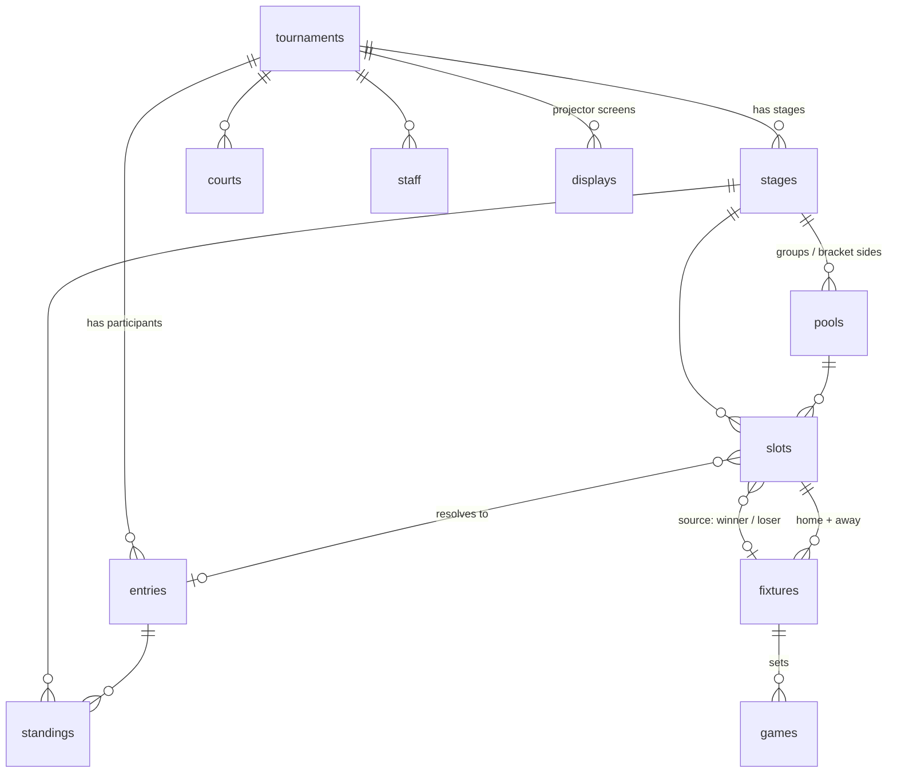

# Data model

## Two decisions everything else follows from

### 1. A tournament is an ordered list of stages, not a fixed shape

Each stage carries its own format. "Groups, then playoff" and "playoff, then
groups" are not two kinds of tournament — they are the same structure with a
different `stages.position`. Adding a consolation bracket or a Swiss round at
the front means inserting a row, not touching the schema.

### 2. A position exists before the participant who fills it

A **slot** is a place that gets filled later: "Winner of QF1", "1st of Pool A".
Until its source resolves, `slot.entry` is null and `slot.label` is displayed.

This is the entire reason the table exists. Without it you cannot draw a
bracket before you know the names — and that is exactly what the projector has
to show all morning, while the group stage is still deciding who is in it.



## Collections

| Collection | What it is |
|---|---|
| `tournaments` | The event. Owner, sport, scoring and tiebreak config. |
| `staff` | Who may operate it (`organizer` / `referee` / `scorer`). |
| `courts` | Playing areas. Used by the schedule and the projector. |
| `entries` | A participant — team or individual. `short_name` is what the projector draws. |
| `stages` | A phase. `position` + `format` + `config`. |
| `pools` | A self-contained sub-competition inside a stage: one round-robin group, or one side of a double-elimination bracket. |
| `slots` | A fillable position. The core of the model. |
| `fixtures` | A match. |
| `games` | Sets / legs / maps inside a fixture. |
| `standings` | A table. Materialised, not a SQL view. |
| `displays` | A projector screen. |

## How a playoff hangs off a group stage

A playoff slot has no `entry`, but it does have a source:

```json
{
  "source_type": "pool_rank",
  "source_pool": "<id of pool A>",
  "source_position": 1,
  "label": "1. A",
  "entry": null
}
```

When pool A finishes, the server recomputes `standings`, finds every slot whose
`source_type` is `pool_rank` pointing at that pool, and fills in `entry`. The
same mechanism handles progression inside a bracket (`fixture_winner`,
`fixture_loser`).

One mechanism, every direction of progression. That is why playoff-first needs
no special case.

**Slots only resolve once the source pool is complete.** Every fixture in it
must be settled. A table is provisional until then, and promoting a
provisionally-first team into the playoff is the single worst bug this system
could have.

Generating such a bracket is one call:

```json
// stages.config on the playoff stage
{ "seedFrom": { "stage": "<groups stage id>", "advancePerPool": 2 } }
```

Qualifiers are ordered by rank first, then by pool — A1 B1 C1 D1 A2 B2 C2 D2 —
which, combined with standard bracket seeding, guarantees no two entries from
the same pool meet in round 1.

## Deliberate impurities

**`fixtures.home_entry` / `away_entry` are denormalised from the slots.**
Without them the projector would have to read `fixtures` → `slots` → `entries`,
two levels of expand. With them it is one query. The cost is that the resolver
has to maintain both — which it does anyway, since it writes both in the same
transaction. The slot is authoritative; `fixtures.*_entry` is cache.

**`standings` is a table, not a view.** SQL can compute points and goal
difference, but not head-to-head — and head-to-head is the first tiebreak in
almost every sport's rules. The server recomputes after each settled fixture
and writes the result, including a `tiebreak` audit recording which criteria
were applied in which order. When somebody disputes a qualification after the
tournament, that field ends the argument. Write rules are nil: only hooks and
superusers touch it.

Two consequences of how ranking works, in `backend/internal/tournament/standings.go`:

- **Tables are rebuilt from scratch, never accumulated.** A score corrected two
  hours later has to yield the same table as if it had been right the first
  time, and incremental accumulation is precisely where that guarantee breaks.
- **Ranking is recursive, not a comparator chain.** Head-to-head is computed
  only among the entries that are actually tied, from the fixtures they played
  against each other. A global comparator cannot see that context, so the
  ranker sorts, groups the still-tied rows, and recurses with the next
  criterion. The default order is
  `points → head_to_head → score_diff → score_for → sub_diff → seed`,
  overridable per tournament via `tournaments.scoring.tiebreakers`.

**`games` is separate even though the scores would fit in a JSON column.** You
need to query "how many sets has team X won in total" for tiebreaks, and that
is not reasonable through JSON.

## Naming: SQL keywords

SQLite reserves `GROUP`, `ORDER`, `MATCH`, `INDEX`, `KEY`, `RANK` and `FILTER`.
All seven are natural words in this domain, so all seven are deliberately
renamed at the storage layer:

| Natural word | In the database | Where |
|---|---|---|
| group | `pool` / `pools` | a group, or a bracket side |
| order | `position` | everywhere |
| match | `fixture` / `fixtures` | a match |
| index | `number` | `games.number` = set number |
| key | `token` | `displays.token` |
| rank | `position` | `standings.position` |
| filter | `scope` | `displays.scope` |

Use "Group A" and "Match" freely in the UI — the renaming is a storage concern.

## Two storage constraints worth remembering

**Uniqueness has to include the pool.** `fixtures` and `slots` are keyed on
`(stage, COALESCE(pool, ''), round, position)`. Leaving the pool out looks
correct for a bracket and breaks the moment a stage has two groups, since pool
A and pool B both hold a fixture at round 0, position 0.

**A required number field rejects 0.** PocketBase validates `required` as "not
blank" and treats 0 as blank, so every zero-based ordering column here (stage
and pool `position`, slot and fixture `round`/`position`) has to be declared
optional. The unique indexes are what actually protect ordering. Fields that
are genuinely 1-based — `games.number`, `standings.position` — stay required.

## The projector

`displays.token` in the URL is the screen's only credential, so it can be
opened on a borrowed laptop without logging in. The read rule is:

```
active = true && token = @request.query.token
```

`listRule` therefore cannot be used to enumerate screens — without the token it
returns nothing.

Screens read `GET /api/display/{token}` rather than the collections directly:
one request returns stages, tables, fixtures, courts and theme already
assembled, instead of five subscriptions joined in the browser.

Three details that matter for a screen:

- **Entries are sent once** as a lookup map keyed by id and referenced from
  every fixture, so a team's name and logo are not repeated dozens of times.
- **Unresolved sides carry a label.** A fixture side with no entry yet sends
  `{ "entry": "", "label": "Winner SF1" }`, so the projector always has
  something to draw.
- **Polling is cheap.** The response is tagged; send it back in
  `If-None-Match` and an unchanged tournament answers 304. The tag excludes
  the generation timestamp, so it only changes when the tournament does.

A draft tournament returns 404 rather than 403, so the endpoint cannot be used
to probe for unpublished events.

## What the model does not solve yet

- **`stage_rank` resolution.** `pool_rank` works. `stage_rank` needs a
  stage-wide table across pools, which nothing computes — pools are ranked,
  stages are not.
- **Swiss pairing** and **double elimination** generators. `pools.kind` already
  has `winners`/`losers`; the code does not exist.
- **Schedule conflicts.** `scheduled_at` and `court` exist, but nothing stops a
  team being booked onto two courts at once.
- **Result history.** An overwritten score is gone. When that starts to matter,
  add an append-only `fixture_events` collection.
